# Relic Swarm — Comprehensive Gameplay Mechanics Analysis, Bug Audit & Architectural Plan

## Executive Summary

**Relic Swarm** is a fast-paced horde survival roguelite built on **React 19**, **Vite 8**, **Tailwind CSS v4**, and an **HTML5 Canvas 2D** simulation engine running a fixed-timestep stepper (60 Hz). The game distinguishes itself in the genre through several standout design hooks:
1. **Dynamic Arsenal Pivoting**: Unlike games that lock inventory early, players have a strict 4-weapon / 4-passive slot limit but can sell equipped gear at any time for a **70% gold refund**, or permanently sacrifice maxed Level 5 items via **Extract Essence** (yielding permanent stat passives).
2. **Deep Dual Upgrade Paths**: Players choose between **Awakened Evolutions** (Base Weapon L5 + paired Passive Relic) and **Weapon Fusions** (Two L5 Weapons merged into a single devastating hybrid, freeing a weapon slot).
3. **Tactical Mobility & Active Defense**: Sprinting is not merely defensive: initiating sprint triggers a stamina-gated **Phase Dash** with i-frames, while continuous sprinting builds a **Momentum** meter that unleashes a radial **Kinetic Burst** upon release.
4. **Spatial Arena Objectives & Scenery**: Procedurally generated solid scenery obstacles (`Stage.ts`) provide tangential sliding and projectile cover, complemented by King-of-the-Hill **Corrupted Obelisks**, elite **Blood Chalice** trials, and the **Wandering Black Market**.
5. **Endless Stage Descent**: A dedicated `LevelManager` scales stages with compound multipliers, weapon level caps, gold carry-over, and intermission selection.

---

## Part 1: Comprehensive Gameplay Mechanics & Features Analysis

### 1.1 Player Character & Core Control Scheme
- **Movement & Physics**: Directional velocity with 8-direction or analog gamepad stick input, clamped to the $\pm 2500\text{ px}$ arena bounds.
- **Phase Dash (Dodge Roll)**:
  - Consumes a flat 35% of max stamina (`DASH_COST_RATIO = 0.35`).
  - Grants 150 ms of full invulnerability (`DASH_DURATION = 0.15`), passes through enemy collision boxes, and boosts speed by $2.8\times$.
  - Triggers on the rising edge of any sprint binding (Shift/Ctrl, Gamepad A/B/LT/RT, mobile touch sprint).
- **Kinetic Charge (Momentum Meter)**:
  - Sprinting while moving fills Momentum from 0 to 100 at 80/s (`~1.25s` to max). Phase Dash gives a flat $+15$ kick.
  - Ending sprint at full Momentum (releasing button or running out of stamina) unleashes a **Kinetic Burst**: 75 base damage ($\times\text{mightMult}$), a $220\text{ px}$ radius shockwave, and strong radial knockback.
- **Derived Stats Pipeline**:
  - `calculateDerivedStats` computes a single cached stats bundle: `maxHp`, `maxStamina`, `mightMult`, `speed`, `cdr`, `magnetRadius`, `greedMult`, `areaMult`, `vitalityLevel`, `toxicLevel`, `frostAmuletLevel`, `baseRegen`, and `armor`.
  - Includes 60s Overdrive buffs from the Black Market ($+40\%$ might, $+20\%$ speed, $+25\%$ CDR, uncapping CDR to 75%).
  - Fragile Glass Pact halves Max HP at the final step.

### 1.2 Weapons & Arsenal Architecture

The weapon system is divided into three distinct progression tiers plus hero-exclusive families:

```mermaid
flowchart TD
    subgraph BaseWeapons["19 Base Weapons (L1-L5, Infinite Tempering)"]
        MM["Magic Missile"]
        FB["Flame Blast"]
        SD["Orbiting Daggers"]
        TS["Thunder Strike"]
        RA["Radiant Aura"]
        VS["Toxic Spores"]
        FS["Glacial Shards"]
        GC["Gilded Chakram"]
        GW["Gravity Well"]
        GL["Grenade Launcher"]
        IL["Inferno Lance"]
        SS["Scattershot"]
        HM["Homing Missiles"]
        CL["Chain Lightning Gun"]
        WA["Whirling Axe (Thorgar)"]
        SG["Spectral Greatsword (Roland)"]
        MS["Meteor Storm (Ignis)"]
        CF["Corrosive Flask (Mortis)"]
        AO["Astral Orb (Vael)"]
    end

    subgraph Evolutions["14 Awakened Evolutions (L5 Weapon + Paired Relic)"]
        CM["Chrono Missiles (+Swift Boots)"]
        HN["Hellfire Nova (+Might Talisman)"]
        PS["Phantom Storm (+Might Talisman)"]
        AZ["Absolute Zero (+Permafrost Sigil)"]
        MC["Mjolnir's Conduit (+Swift Boots)"]
        SE["Solar Eclipse (+Vitality Charm)"]
        NB["Necrotic Blight (+Toxic Vial)"]
        MW["Midas' Wrath (+Greed Coin)"]
        EH["Event Horizon (+Attraction Rune)"]
        CMIRV["MIRV Cluster Mortar (+Might)"]
        PR["Phoenix Ray (+Vitality Charm)"]
        BR["Bloodreaver (Thorgar)"]
        TO["Tempest Oath (Roland)"]
        ARM["Armageddon (Ignis)"]
        PC["Pandemic Cauldron (Mortis)"]
        AS["Astral Singularity (Vael)"]
    end

    subgraph Fusions["9 Weapon Fusions (Two L5 Weapons Consumed)"]
        APV["Arcane Phantom Vortex (MM + SD)"]
        CSN["Cataclysmic Supernova (FB + TS)"]
        TXS["Plague Sanctuary (RA + VS)"]
        SHT["Shatterstorm (FS + TS)"]
        FBC["Frostbite Chakrams (FS + SD)"]
        SFB["Stormfront Barrage (SS + HM)"]
        CRS["Cryo Singularity (GW + FS)"]
        NSM["Napalm Siege Mortar (GL + FB)"]
        FFP["Frostfire Prism (IL + FS)"]
        TC["Thunder Cleaver (WA + CL)"]
        DB["Dawnbreaker (SG + RA)"]
        CST["Collapsing Star (MS + GW)"]
        BS["Blight Seekers (CF + HM)"]
        SO["Storm Orb (AO + TS)"]
    end

    BaseWeapons -->|L5 + Passive| Evolutions
    BaseWeapons -->|Two L5s or Black Market Catalyst| Fusions
```

- **Hero Signature Families**:
  - Each hero has exactly one exclusive signature family:
    - **Thorgar**: Whirling Axe $\rightarrow$ Bloodreaver (Lifesteal) / Thunder Cleaver (Lightning arc)
    - **Roland**: Spectral Greatsword $\rightarrow$ Tempest Oath (Whirlwind) / Dawnbreaker (Holy crescent)
    - **Ignis**: Meteor Storm $\rightarrow$ Armageddon (Fire pools) / Collapsing Star (Singularity meteors)
    - **Mortis**: Corrosive Flask $\rightarrow$ Pandemic Cauldron (Armor shred) / Blight Seekers (Homing acid)
    - **Vael**: Astral Orb $\rightarrow$ Astral Singularity (Gravity suction) / Storm Orb (Thunder bolts)
  - `Draft.ts` enforces `heroId` exclusivity so other heroes never draft them.

### 1.3 Combat Systems & Elemental Interactions
- **Damage Pipeline**:
  - `damageEnemy(enemy, amount, armorScale)`:
    - Armoured mobs apply a flat 30% reduction plus `armor * armorScale`, with a 15% damage passthrough floor: `max(0.15 * dmg, 0.70 * dmg - armor * armorScale)`.
    - Continuous damage uses `dt` for `armorScale` (charging armor per second); DoTs bypass armor (`armorScale = 0`).
    - Resets `regenDelay` to 2.0s on hit.
  - `hitEnemy(sim, enemy, amount, weaponId)`:
    - Choke point for discrete weapon hits. Applies weapon boosters (Burn, Poison, Frost, Knockback).
- **Elemental Synergies & Reactions**:
  - **Vapor Ignition**: When a Spore Cloud (`type: 'spore'`) overlaps a Flame Pool (`type: 'flame_pool'`), it violently detonates for $2.8\times\text{spore} + 2.2\times\text{flame}$ damage, shakes the screen, and consumes the cloud.
  - **Thermal Shock**: When ice attacks strike burning enemies, they shatter the burn for bonus burst damage and consume the burn.
  - **Necrotic Blight**: Enemies dying while poisoned explode into homing plague beetles.

### 1.4 Enemy Escalation & Boss Encounters
- **Spawn Escalation**:
  - Base rate doubles every 180s: `baseSpawnRate * (1 + runTimer / 180) * obeliskSpawnMult`.
  - Archetypes unlock by time: Bats at 20s, Hounds at 40s, Sorcerers at 60s, Elites at 30s ($3.5\times\text{ HP}$, $1.5\times\text{ damage}$).
  - Tank traits roll after 45–90s: **Brute** ($6\times\text{ HP}$, slower, heavier), **Armoured** ($2.5\times\text{ HP}$, flat armor scaling +3/min), **Regenerating** ($2\times\text{ HP}$, 6% HP/s after 2s without damage).
- **Abyssal Titan (Boss Fight at 300s)**:
  - 35,000 Base HP scaling $1.25\times$ per endless stage.
  - **Aegis Force Field**: Invulnerable with a rotating hexagonal shield until all escort minions (minimum 60) are destroyed.
  - Radial bullet-hell orbs that collide with and dissipate against solid terrain.
  - With **Titan's Wrath** pact, twin Titans spawn on opposite flanks.

### 1.5 Arena Objectives, Economy & Endless Descent
- **Corrupted Obelisks**: Spawn periodically at 35s+; standing in the 150px zone charges it while buffing swarm speed and spawn rates by 30%. Reaching 100% emits an arena shockwave and drops a chest or magnet.
- **Blood Chalice**: Elites have a 10% chance to drop a chalice, creating a $600\times 600\text{ px}$ walled arena for 20s with an elite minion, rewarding a chest, gold, and purple XP upon survival.
- **Wandering Black Market**: Stationary cart appearing every 1–2 minutes, offering 60s Overdrive (100g), Blacksmith Tempering (175g), Arcane Fusion Catalyst (250g), or Smuggler's Fortune Cache (200g). Strictly one purchase per visit.
- **Economy**:
  - **Run Gold** (in-run pouch) vs. **Vault Gold** (persistent meta currency stored in localStorage, boosted by Pact of the Swarm).
  - Wealth scaling: Gilded Chakram ($+1\%$ dmg / 50g), Midas' Wrath ($+2\%$ dmg / 50g).
- **Endless Mode (`LevelManager.ts`)**:
  - Stages scale Enemy HP $+10\%$, Enemy Damage $+10\%$, and Player Speed $+10\%$ per stage.
  - Player carries over 1 chosen weapon (level capped at $\text{Stage}\times 5$ with a 70% refund for excess levels) and 100% of unbanked run gold.
  - Unchosen weapons and passives are auto-refunded at 70% gold.

---

## Part 2: In-Depth Code Review & Resolved Bug Audit

### 2.1 Critical Invariants & Combat Fixes (P0)

#### [x] Bug #1: Direct `enemy.hp -= shockDmg` in `App.tsx` (Violated Rule 2.7b)
- **File & Line**: `src/App.tsx:1327`
- **Severity**: **P0 / Invariant Violation**
- **Issue**: Obelisk purification shockwave directly decremented `enemy.hp -= shockDmg`, bypassing `damageEnemy()`, ignoring armor reduction rules, and failing to pause enemy health regeneration.
- **Resolution**: Routed through `damageEnemy(enemy, shockDmg, 0)` with `armorScale = 0` (armor-piercing holy burst) and updated floating combat damage text with the actual damage dealt.

#### [x] Bug #2: Enemy Damage Scaling Overwritten for Hounds, Bats, and Sorcerers
- **File & Line**: `src/entities/Spawner.ts:329, 336, 343`
- **Severity**: **P0 / Balance Defect**
- **Issue**: While skeletons scaled via `damage = 10 * enemyDamageMult`, lines 329, 336, and 343 reassigned flat `14`, `8`, and `18` to hounds, bats, and sorcerers, nullifying endless realm and pact damage multipliers for all non-skeleton enemies.
- **Resolution**: Multiplied all three by `enemyDamageMult` (`14 * enemyDamageMult`, etc.).

#### [x] Bug #3: Signature Weapon Evolutions Cast at Level 1 Base Damage
- **File & Line**: `src/entities/SignatureWeapons.ts:123-125`
- **Severity**: **P0 / Progression Flaw**
- **Issue**: `lv` was correctly set to 5 for evolutions, but `baseDmg` computed `(1 + (wep.level - 1) * 0.2)` using `wep.level` (which starts at 1 for newly awakened evolutions). As a result, an awakened evolution dealt lower base damage than a high-level unevolved base weapon!
- **Resolution**: Updated `baseDmg` formula to use `lv = (def.isEvolution || def.isFusion) ? Math.max(5, wep.level) : wep.level`, ensuring awakened evolutions always strike at full tier-5 multiplier.

---

### 2.2 Performance & Zero-Allocation Invariants (P1 / P2)

#### [x] Bug #4: Global $O(N)$ Enemy Scan in `Player.ts`
- **File & Line**: `src/entities/Player.ts:343-348`
- **Severity**: **P1 / Performance Invariant**
- **Issue**: The Permafrost Sigil passive ran `sim.enemies.forEach` over all 180 enemies across the entire $5000\times 5000\text{ px}$ map at 60 Hz.
- **Resolution**: Replaced with `spatialGrid.forEachNearby` using a preallocated module-level context object `frostCtx`, eliminating per-frame closure and array allocations.

#### [x] Bug #5: $O(N \log N)$ Array Allocation in Gilded Chakram Inner Loop
- **File & Line**: `src/entities/Weapons.ts:766-768`
- **Severity**: **P1 / Frame Drop Risk**
- **Issue**: Gilded Chakram allocated a new array and sorted all active enemies via `[...sim.enemies].sort(...)` on every volley.
- **Resolution**: Replaced with `getClosestEnemies(sim.x, sim.y, sim.enemies, count)`, eliminating heap allocation and redundant square root calls.

#### [x] Bug #6: Per-Frame Closure Allocation in `updateEnemies`
- **File & Line**: `src/entities/Spawner.ts:829-835`
- **Severity**: **P2 / GC Pressure**
- **Issue**: Tallying boss minions and detecting boss presence ran `sim.enemies.reduce(...)`, `.some(...)`, and `.find(...)`, creating 3 arrow function closures every frame tick at 60 Hz.
- **Resolution**: Replaced with a single fast `for` loop that tallies minions and captures the boss reference in a single pass with zero closures.

#### [x] Bug #7: `ctx.shadowBlur` 100% Purge Across All Render Layers
- **File & Line**: `src/core/renderer.ts:85, 130, 218, 235, 286, 300, 1335, 1385`
- **Severity**: **P2 / GPU Stall Risk**
- **Issue**: Mjolnir Conduit pylons, obelisk crystals, arena walls, merchant signs, and off-screen arrows used `ctx.shadowBlur = 8 / 12`, triggering Skia multi-pass gaussian blur stalls on high-refresh displays (`GEMINI.md` §2.7).
- **Resolution**: Replaced 100% of `shadowBlur` calls across all 8 layers with layered alpha strokes, glowing core diamonds, and crisp pixel-art stroke outlines.

#### [x] Bug #8: $O(1)$ Swap-Pop Entity Removal (Eliminating In-Loop `splice`)
- **File & Line**: `Spawner.ts:715`, `Projectiles.ts:893`, `Drops.ts:80, 174`
- **Severity**: **P1 / Performance Optimization**
- **Issue**: `array.splice(i, 1)` caused $O(N)$ memory copies on every despawn in backward iteration loops, causing $O(N^2)$ memory shifts during mass wave wipes.
- **Resolution**: Replaced all backward-loop `splice(i, 1)` calls with $O(1)$ swap-and-pop (`const last = arr.pop()!; if (i < arr.length) arr[i] = last;`).

#### [x] Bug #9: Viewport / Camera Frustum Culling
- **File & Line**: `src/core/renderer.ts:22-28, 334, 437, 735`
- **Severity**: **P1 / CPU Render Optimization**
- **Issue**: `renderGame` executed path setup, fills, strokes, and sprite blits for all 180 enemies, 160 drops, and 80+ projectiles even when 70–80% were outside the camera view.
- **Resolution**: Added camera AABB frustum culling (`viewMinX`, `viewMaxX`, `viewMinY`, `viewMaxY`), skipping off-screen drops, regular enemies, and non-beam projectiles.

---

### 2.3 UI & Configuration Parity (P1 / P2 / P3)

#### [x] Bug #10: PauseMenu Active Objective Banner Misidentified Merchant as Obelisk
- **File & Line**: `src/ui/PauseMenu.tsx:112-135`
- **Severity**: **P1 / UI Polish**
- **Issue**: When the Black Market cart spawned, `PauseMenu` defaulted non-blood trials to `Corrupted Obelisk: 480% Purified`.
- **Resolution**: Added explicit `MERCHANT` case with `ShoppingBag` icon, emerald styling, and `"Black Market Cart: Xm Away"` banner.

#### [x] Bug #11: Chest Reward Gold Mislabeled as "Sanctum Gold"
- **File & Line**: `src/ui/ChestModal.tsx:31`
- **Severity**: **P2 / Economic Polish**
- **Issue**: Modal text stated `+X Sanctum Gold Acquired`, misleading players since chest gold goes to in-run pouch gold (`sim.gold`), which is spent at the Black Market and only banked on run conclusion.
- **Resolution**: Updated copy to `+{chestReward.gold} Gold Acquired`.

#### [x] Bug #12: `maxEnemies` Limit Inconsistency
- **File & Line**: `playground_config.json:34` & `src/entities/Spawner.ts:136`
- **Severity**: **P3 / Config Parity**
- **Issue**: `constants.ts` and `GEMINI.md` specify 180 max enemies, while `playground_config.json` and `Spawner.ts` fallback had 250.
- **Resolution**: Aligned both `playground_config.json` default and `Spawner.ts` fallback to `180`.

#### [x] Bug #13: Screen Shake Toggle Unwired
- **File & Line**: `engine.ts:25`, `App.tsx:1197`
- **Severity**: **P2 / Accessibility**
- **Issue**: `screenShakeEnabled` existed in settings, but all 21 shake sites updated `sim.screenShake` unconditionally.
- **Resolution**: `getScreenShakeOffset()` now returns `{shakeX: 0, shakeY: 0}` if `getConfig('screenShakeEnabled') === false`, and `updateScreenShake` handles frame decay.

#### [x] Bug #14: Boss Escort Leash Anchored to Player Instead of Boss
- **File & Line**: `Spawner.ts:720-738`
- **Severity**: **P1 / Encounter Design**
- **Issue**: Minions >950px away were leashed around `sim.x, sim.y` (the player), causing tether lines to stretch 2000px across the map when kiting.
- **Resolution**: Leash anchor now targets `activeBossEntity || sim`, preserving the protective Aegis phalanx circle around the Titan.

#### [x] Bug #15: Roland's Melee Slash Visual Prematurely Culled
- **File & Line**: `SignatureWeapons.ts:28`
- **Severity**: **P2 / Visual Polish**
- **Issue**: `isProtectedSignatureType` excluded `'slash'`, allowing the 120-projectile cap to cull Roland's greatsword visual mid-swing.
- **Resolution**: `isProtectedSignatureType` now protects all signature projectile types including `'slash'`.

#### [x] Bug #16: Symmetrical Thermal Shock
- **File & Line**: `Boosters.ts:140-175`, `Projectiles.ts`
- **Severity**: **P2 / Elemental Balance**
- **Issue**: 4 separate Thermal Shock implementations with different multipliers (1.5×–2.0×), and fire hitting chilled targets never triggered it.
- **Resolution**: Unified into `triggerThermalShock()` in `Boosters.ts`, with symmetrical triggering for both Frost on Burn and Fire on Chill.

#### [x] Bug #17: Keyboard Navigation Parity in SanctumShop and DraftModal
- **File & Line**: `App.tsx:1543-1570, 1680`
- **Severity**: **P1 / Input Parity Invariant**
- **Issue**: `DraftModal` lacked `KeyX` handler for "Sell Items [X]", and `SanctumShop` only supported Escape (no WASD/Arrow navigation).
- **Resolution**: Added WASD/Arrow navigation and Enter/Space purchasing in `SanctumShop`, and added `x`/`X` sell sheet toggle in `DraftModal`.

---

## Part 3: Deep Insights & Synthesis with `ANALYSIS.md`

`ANALYSIS.md` documented notable insights from external subagents and a direct mechanics pass. Below is the comparative synthesis and roadmap for those findings:

| Insight from `ANALYSIS.md` | Code Location | Status & Technical Analysis |
|:---|:---|:---|
| [x] **Enemy Damage Scaling** | `Spawner.ts:329-343` | **FIXED**. Multiplied hounds, bats, and sorcerers by `enemyDamageMult`. |
| [x] **Signature Evolution Damage** | `SignatureWeapons.ts:123-125` | **FIXED**. `baseDmg` scales using `lv = Math.max(5, wep.level)`. |
| [x] **Max Enemies Cap Discrepancy** | `playground_config.json`, `Spawner.ts` | **FIXED**. Standardized to 180 across all files. |
| [x] **Screen Shake Setting Dead** | `engine.ts`, `App.tsx` | **FIXED**. `getScreenShakeOffset()` now checks `getConfig('screenShakeEnabled') === false` to cleanly disable camera shake, and uses `updateScreenShake(sim.screenShake, dt, 30)` decay. |
| [x] **Boss Escort Leashing Anchor** | `Spawner.ts:720-738` | **FIXED**. Stray minions (>950px) now leash directly to `activeBossEntity || sim`, preserving the circular Aegis phalanx around the Titan. |
| [x] **Roland's Slash Visual Culled** | `SignatureWeapons.ts:28` | **FIXED**. `isProtectedSignatureType` now protects `'slash'`, preventing Roland's greatsword visuals from being culled during bullet-hell spam. |
| [x] **Thermal Shock Inconsistency** | `Boosters.ts`, `Projectiles.ts` | **FIXED**. Consolidated into unified `triggerThermalShock()` in `Boosters.ts` with bi-directional synergy (Frost on Burn and Fire on Chill). |
| [x] **Input Scheme Parity Gaps** | `App.tsx:1543-1570, 1680` | **FIXED**. Added WASD/Arrow navigation and Enter/Space purchasing in `SanctumShop`, plus `KeyX` sell sheet toggle in `DraftModal`. |
| [x] **Swap-Pop Removal (O(1))** | `Spawner.ts`, `Projectiles.ts`, `Drops.ts` | **FIXED**. Replaced all `splice(i, 1)` array shifts in backward loops with $O(1)$ swap-and-pop entity removal. |
| [x] **Frustum / Viewport Culling** | `renderer.ts:334, 437, 735` | **FIXED**. Added camera AABB bounds checking to skip drawing off-screen drops, enemies, and projectiles, eliminating 70-80% of canvas draw calls. |
| [x] **Purged All Remaining `shadowBlur`** | `renderer.ts` | **FIXED**. Replaced all remaining canvas blur calls on obelisk crystals, arena walls, merchant signs, and off-screen arrows with crisp outlines and layered alpha strokes. |
| [ ] **Dead `itemDropChance` Config** | `Spawner.ts:636` | **Identified**: `dropRoll < 0.7` is hardcoded instead of querying `getConfig('itemDropChance')`. |
| [ ] **Drop-Merge Hysteresis O(n²)** | `Drops.ts:40-75` | **Identified**: When drops exceed 90, `updateDrops` merges pairs until 70. |

---

## Part 4: Verification Checklist & System Status

- [x] **Zero TypeScript Errors**: Tested via `tsrs -p . --noEmit`
- [x] **Vite Production Bundle Clean**: `npm run build` completed in **350ms**
- [x] **GEMINI.md Compliance**:
  - [x] Rule 2.7b: All damage funneled through `damageEnemy()`
  - [x] Rule 2.7: Zero `ctx.shadowBlur` in inner loops
  - [x] Rule 2.8: Zero allocation in per-frame update/draw paths; 180 mob cap enforced
  - [x] Button 9 gamepad pause invariant preserved
  - [x] 1280x720 logical canvas resolution preserved
