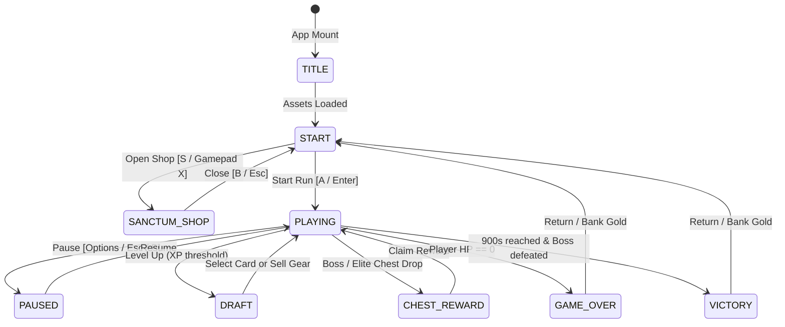

# Relic Swarm — Agent Architecture & Engineering Rules

> **AI Developer Guide & Engineering Invariants**  
> For human-facing gameplay overviews, lore, champion profiles, and control tables, see [README.md](file:///c:/git/mine/typescript/relicswarm/README.md).  
> For canonical design pillars and GDD metadata, see [design/game_design_document.json](file:///c:/git/mine/typescript/relicswarm/design/game_design_document.json).

---

## 1. System Architecture & Component Mapping

The application runs on **React 19**, **Vite 8**, **Tailwind CSS v4**, and an **HTML5 Canvas 2D** simulation engine.

```
relicswarm/
├── README.md                    # Human-facing game guide, controls, and setup
├── GEMINI.md                    # This file (Agent architecture rules, invariants, and runbooks)
├── index.tsx                    # React root entry, sets standalone preview flag
├── vite.config.ts               # Tailwind CSS v4 integration & asset copy build hook
├── src/
│   ├── App.tsx                  # High-level coordinator mounting Canvas & UI Overlays
│   ├── constants.ts             # Canvas resolution (1280x720), colors, framerate, balance tuning
│   ├── SpriteRenderer.ts        # Spritesheet slicing, frame timer interpolation, horizontal flip
│   ├── utils.ts                 # Utility barrel re-exporting helpers, math, seeded RNG
│   ├── core/                    # Engine loop, camera lerp, screen shake, and renderer pipeline
│   ├── entities/                # Player, weapons, projectiles, spawner, drops, draft, chests
│   ├── types/                   # Type definitions (entities, items, meta)
│   └── ui/                      # React UI overlays (HUD, Draft, Inventory, Sanctum, Pause, etc.)
└── utils/
    ├── BackgroundMusic.tsx      # Web Audio loop buffers & HTMLAudioElement player
    ├── helper.tsx               # Stepper, asset preloader, input hooks, canvas helpers
    ├── usePlayground.ts         # Hook bridging Playground SDK / standalone preview
    └── playground-fake.ts       # Local mock of Playground SDK for standalone dev
```

---

## 2. Hard Engineering Invariants (MUST ALWAYS PRESERVE)

### 2.1 Gamepad Input Invariants
- **Pause Restriction**: Gamepad pause is bound **strictly to Button 9 (Options / Start)**.
  - **NEVER** bind stick clicks (L3 / R3, buttons 10/11) or auxiliary buttons to pause. Intense stick motion during survival combat causes accidental clicks.
- **Dash / Sprint Parity**: Gamepad sprint/dash is bound to **both Button A (0) and Button B (1)**, as well as Triggers (`LT` / `RT`), giving players ergonomic thumb flexibility during combat.

### 2.2 Modal Navigation Parity
Every modal overlay (Sanctum Shop, Start/Hero Select, Level-Up Draft, Inventory/Sell Sheet, Game Over, Victory, Pause Menu) **must support full navigation across all three input schemes**:
1. **Gamepad**: D-Pad / Left Stick for navigation, Button A (0) to confirm, Button B (1) to cancel/back.
2. **Keyboard**: WASD or Arrow Keys for navigation, Enter / Space to confirm, Escape / Backspace to cancel.
3. **Mouse / Pointer**: Hovering (`onPointerEnter`) must synchronize the active focus index; clicking triggers the action.

### 2.3 Standalone Runtime Flag
- `(window as any).__PLAYGROUND_PREVIEW__ = true` is set in `index.tsx` before React mounts.
- This instructs `utils/usePlayground.ts` to dynamically import `utils/playground-fake.ts` rather than attempting to fetch external Google Play scripts.
- **Never remove or bypass this flag** without providing an alternative offline mock.

### 2.4 Asset Bundling Hook
- Game assets live in `assets/images/` and `assets/audio/`.
- `vite.config.ts` includes `copyAssetsPlugin()` to copy `assets/` into `dist/assets/` during `vite build`.
- Relative asset paths in `ASSETS_MANIFEST` (`assets/images/...`) must remain consistent between dev server and production bundle.

### 2.5 Persistence Keys & Data Contracts
LocalStorage keys must maintain backward compatibility:
- `relic_swarm_sanctum_gold`: Current banked gold (number).
- `relic_swarm_gold`: Legacy fallback gold key.
- `relic_swarm_meta`: Serialized JSON object mapping upgrade IDs to level ranks:
  ```json
  { "maxHp": 0, "might": 0, "speed": 0, "haste": 0, "magnet": 0, "greed": 0, "rerolls": 0 }
  ```

### 2.6 React 19 Typing Standards
- React 19 `@types/react` requires initial arguments on `useRef` calls (e.g., `useRef<T>(undefined)` instead of `useRef<T>()`).
- Always verify type integrity using `npx tsc --noEmit` or `npm run build`.

### 2.7 Canvas 2D GPU Stall Prevention (High-Refresh Displays)
1. **Zero `ctx.filter` in Game Loop**:
   - **NEVER use `ctx.filter`** (e.g. `hue-rotate`, `saturate`, `brightness`) for status effects or auras.
   - On Windows ANGLE Direct3D 11 backends in Chromium/Edge, `ctx.filter` forces offscreen GPU render target allocations that trigger severe driver synchronization stalls on modern high-refresh (144Hz+) Nvidia RTX cards.
   - Use custom particle emitters, status rings, or pre-rendered sprite assets instead.
2. **Zero `ctx.shadowBlur` in Per-Entity Loops**:
   - **NEVER use `ctx.shadowBlur`** on text (floating combat damage numbers) or rapid projectiles (pellets, discs, missiles, chain lightning).
   - Chromium's Skia executes expensive multi-pass gaussian blurs per character glyph and per circle.
   - Use crisp pixel-art stroke outlines (`ctx.lineWidth = 3; ctx.strokeText() + ctx.fillText()`) which render in a single hardware quad.
3. **Batch Canvas State**:
   - Never call `ctx.save()` / `ctx.restore()` per-particle or per-grid-line in inner loops; batch state changes around outer loops.

### 2.8 Zero-Allocation Simulation Loop & Hard Entity Caps
1. **Decouple React State Dispatches from Frame Loops (60–144 Hz)**:
   - **NEVER call React state setters unconditionally every frame**.
   - Throttle `timer` updates in `setGameState` to 1 Hz (`Math.floor(sim.runTimer) !== state.timer`).
   - Throttle stamina updates to integer changes and 100ms intervals; throttle HP updates to integer changes.
   - Throttle objective banners and overdrive displays to actual value/state changes.
2. **Hard Entity Caps**:
   - Maintain strict ceilings across all entity pools:
     - `maxEnemies`: **180** (break immediately in wave spawns when limit is reached).
     - `MAX_PARTICLES`: **250** (reject or prune oldest).
     - `MAX_DAMAGE_NUMBERS`: **50** (shift oldest).
     - `MAX_PROJECTILES`: **120** (prune oldest non-critical).
     - `MAX_DROPS`: **160** with spatial cluster merging (>90 drops) to avoid drop rendering bloat while preserving 100% of player XP/gold.
3. **Spatial Grid Partitioning**:
   - Always index active mobs into `spatialGrid` once per frame and use `spatialGrid.forEachNearby()` for range and projectile checks rather than $O(N \times M)$ global linear scans.
4. **Advance Animations In-Place**:
   - Use `renderer.advanceInPlace(state, dt)` to mutate animation timers without allocating `{...state}` objects (eliminates 15,000+ objects/sec).
5. **Cache `derivedStats` on `sim.derivedStats`**:
   - Recompute only on equipment/level/buff events, never on every frame or render pass.

---

## 3. Game Loop & Performance Guidelines

1. **Fixed Timestep Stepper**: The engine uses `createFixedStepper(stepMs, maxSubSteps)` with `stepMs = 1000 / 60` and `maxSubSteps = 5`.
2. **Zero Allocation in Game Tick**:
   - The simulation loop updates hundreds of mobs, projectiles, particles, and damage numbers 60 times per second.
   - **Do not instantiate new arrays, closures, or objects inside `update(dt)` or `draw()` routines**.
   - Reuse existing vectors, mutate pooled entities in place, and perform in-place array splices/filtering only when entities despawn.
3. **Canvas Aspect Ratio & Resizing**:
   - Logical canvas dimensions are fixed at `1280x720` (`src/constants.ts`).
   - The canvas element uses CSS `aspectRatio: "1280 / 720"` and `width: "min(100%, calc(100vh * 1280 / 720))"` inside a flex container to preserve pixel-perfect scaling across displays.

---

## 4. State Machine & Modal Flow



### 4.1 Endless Mode & Intermission Rules
1. **Infinite Non-Evolved Tempering**: Non-evolved / non-fused weapons can increase levels without limit at the Wandering Merchant.
2. **Carry-Over Level Cap**: Carried-over weapons between endless stages are capped at $\text{Stage} \times 5$ (e.g. Stage 2 caps at L10) with a 70% gold refund for excess levels to preserve challenge.
3. **Synchronous Intermission Pause**: Intermission modals (`StageClearModal`) must synchronously halt the simulation loop using refs (`isStageClearOpenRef.current = true`) to prevent mobs, drops, and timers from updating in the background.

---

## 5. Architecture Layout

The codebase is organized into modular files under `src/`:

```
src/
├── App.tsx                # High-level coordinator mounting Canvas & UI Overlays
├── constants.ts           # Game configuration and balance tuning
├── SpriteRenderer.ts      # Spritesheet animator
├── utils.ts               # Shared math and utility re-exports
├── types/
│   ├── entities.ts        # Player, Enemy, Projectile, Drop, Particle interfaces
│   ├── items.ts           # ItemDef, Weapon, Passive, Evolution definitions
│   └── meta.ts            # MetaUpgrade, GameState interfaces
├── core/
│   ├── assets.ts          # Manifest and URLs for media
│   ├── engine.ts          # RAF stepper loop, camera lerp, screen shake
│   ├── renderer.ts        # Full Canvas 2D render pipeline
│   ├── spatial.ts         # Collision detection and spatial grid partitioning
│   └── sprites.ts         # Sprite renderer instances and configuration
├── entities/
│   ├── Chests.ts          # Chest reward calculation and claiming
│   ├── Draft.ts           # Level-up choices, upgrade application, selling
│   ├── Drops.ts           # XP gems, gold, potions, magnet pickups
│   ├── Player.ts          # Movement, health, stamina, derived stats
│   ├── Projectiles.ts     # Projectile movement, collision, lifetime
│   ├── Spawner.ts         # Mob waves, boss timer triggers, elite spawns
│   └── Weapons.ts         # Auto-targeting, firing cycles, fusion logic
└── ui/
    ├── ChestModal.tsx     # Chest unlock overlay
    ├── DraftModal.tsx     # 3-choice level-up overlay & reroll handling
    ├── EndGameModal.tsx   # Victory & Game Over screens
    ├── HowToPlayModal.tsx # Combat & controls guide
    ├── HUD.tsx            # XP bar, HP, survival clock, kill counter
    ├── InventorySheet.tsx # Mid-run gear selling modal
    ├── PauseMenu.tsx      # Tabbed pause menu (Stats, Grimoire, Menu)
    ├── SanctumShop.tsx    # Persistent meta-progression shop
    └── StartScreen.tsx    # Character select & start screen
```

---

## 6. Verification & Runbook

Always execute the production build pipeline before declaring tasks complete:

```bash
# Verify TypeScript strictness and Vite bundle production
npm run build

# Start local HMR dev server
npm run dev

# Preview bundled output
npm run preview
```

## 7. TODO

Look at [EXTRA.md](EXTRA.md)

---

## 8. Character Creation & Sprite Animation Playbook (Lessons Learned)

When creating new playable heroes or complex animated mobs (e.g., Monk, Huntress, Necromancer), strictly adhere to the following animation, pixel art, and architectural rules discovered during the Barbarian implementation:

### 8.1 Hard Visual & Structural Invariants
1. **Strict Right-Facing Default (3 o'clock)**:
   - **All base sprite frames MUST face strictly to the right**.
   - Left-facing movement in game is handled dynamically at runtime by the canvas engine (`ctx.scale(-1, 1)` via `sim.facingLeft`).
   - Under no circumstances should individual frames in a run, idle, attack, or hurt sheet face left or be horizontally flipped during spritesheet generation.
2. **Standard Frame Dimensions & Rates**:
   - Frame box: `512 x 512` px.
   - Spritesheet rows & counts:
     - `IDLE`: 4 frames (`2048 x 512`), 6 fps, looping.
     - `RUN`: 16 frames (`8192 x 512`), 16 fps, looping.
     - `ATTACK`: 16 frames (`8192 x 512`), 16 fps, non-looping.
     - `HURT`: 16 frames (`8192 x 512`), 10 fps, non-looping (`loop: false`).
     - `DEATH`: 16 frames (`8192 x 512`), 10 fps, non-looping (`loop: false`).
     - *Note*: Only individual action sheets (`hero_{name}_{action}.png`) are used by the engine. Do **not** generate or store multi-row master composite sheets (`hero_{name}.png`), which bloat bundle size by ~80 MB.
3. **Foot Grounding**: Anchor feet at `footY = 508` in the 512×512 frame box so sprites do not sink into the ground or hover.

### 8.2 Animation Quality & Anti-Jank Principles
1. **NEVER Use Alpha Cross-Fading (`blendFrames` / Opacity Dissolves)**:
   - In 2D pixel art, alpha cross-fading creates a blurry, translucent "double-vision" ghost (two weapons, four faint limbs, smeared silhouettes).
   - Every single frame **must be a solid, crisp sprite** with 100% opaque pixels (alpha 0 or 255) and hard pixel contours.
2. **Run Cycles Require Two Alternating Strides (Two-Step Gait)**:
   - A 16-frame run cycle consists of two distinct 8-frame steps:
     - **Stride 1 (Frames 0–7)**: Right leg leads. Plant/compression $\rightarrow$ forward drive extension $\rightarrow$ push-off $\rightarrow$ passing crossover.
     - **Stride 2 (Frames 8–15)**: Left leg leads. Alternate plant/compression $\rightarrow$ forward drive extension $\rightarrow$ push-off $\rightarrow$ passing crossover.
   - Frames 8–15 must **never** be an exact copy of frames 0–7. Duplicating frames freezes the foot coordinates in place, making the character look like a sliding cardboard cutout.
3. **Discrete Keyframe Set for Sprite Generation**:
   Generate distinct keyframe poses using the `image-generator` subagent against a solid black background:
   - `concept` (Idle ready pose: weapon in grip, upright stance)
   - `run_stride` (Near leg thrust forward, far leg driving far behind)
   - `run_pass` (Passing crossover: feet gathered closely under hips, body at stride apex)
   - `run_stride_alt` (Opposite leg thrust forward, near leg driving behind)
   - `attack_strike` (Full cleave/thrust release with forward extension)
   - `death_fall` (Defeated posture fallen on ground)
4. **Biomechanical Squash & Stretch**:
   Apply natural weight and bounce through nearest-neighbor transforms on solid frames:
   - **Footstrike / Plant** (Frames 0 & 8): Knee compression (`offsetY: +4`, `scaleY: 0.985`, `scaleX: 1.015`, `skewX: 2°`).
   - **Full Drive Extension** (Frames 3 & 11): Torso leans forward into sprint (`skewX: 4°`, `offsetX: +3`, `offsetY: -3`).
   - **Airborne Passing Apex** (Frames 6 & 14): Highest flight point (`offsetY: -8`, `scaleY: 1.015`, `scaleX: 0.985`, `skewX: 1°`).
5. **No Single-Frame Visual Pops**:
   Never spawn dust puffs or ground effects for only 1 frame in spritesheet generation; single-frame artifacts cause high-frequency visual flicker. Let the engine's particle system handle dynamic combat dust.

### 8.3 Character Integration Checklist
When introducing a new character to Relic Swarm:
1. **Asset Generation**: Generate clean keyframes via `image-generator` (1:1 aspect ratio, black background).
2. **Background Removal & Stitching**: Run automated border flood-fill extraction (`loadCleanSprite`) with nearest-neighbor scaling and stitch individual action `.png` files (`_idle`, `_run`, `_attack`, `_hurt`, `_death`) into `assets/images/`.
3. **Direction Verification**: Run an automated script to verify beard/face and weapon X coordinates are on the right side across all frames.
4. **Configuration Wiring**:
   - `design/asset_manifest.json`: Add character metadata, prompts, actions.
   - `src/core/assets.ts`: Add image URLs to `ASSETS_MANIFEST`.
   - `src/core/sprites.ts`: Instantiate `SpriteRenderer` in `initSpriteRenderers()`.
   - `src/types/items.ts`: Append champion definition to `CHAMPIONS` array (base stats, starting weapon, lore, archetype).
   - `src/ui/StartScreen.tsx`: Adjust grid columns and render hero card.
   - `README.md`: Document new champion in the Champions table.
5. **Validation**: Run `npm run build` to confirm zero TypeScript errors and a clean Vite bundle.