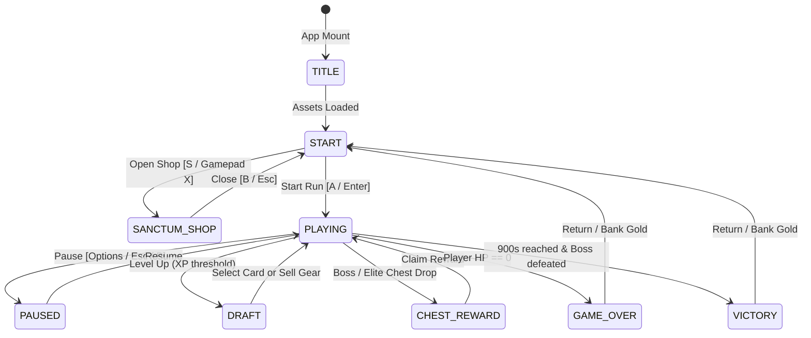

# Relic Swarm — Agent Architecture & Engineering Rules

> **AI Developer Guide & Engineering Invariants**  
> For human-facing gameplay overviews, lore, champion profiles, and control tables, see [README.md](file:///c:/git/mine/typescript/relicswarm/README.md).  
> For canonical design pillars and GDD metadata, see [design/game_design_document.json](file:///c:/git/mine/typescript/relicswarm/design/game_design_document.json).

---

## 1. System Architecture & Component Mapping

The application runs on **React 19**, **Vite 8**, **Tailwind CSS v4**, and an **HTML5 Canvas 2D** simulation engine.

```
relicswarm/
├── README.md                    # Human-facing game guide, controls, and setup
├── GEMINI.md                    # This file (Agent architecture rules, invariants, and runbooks)
├── index.tsx                    # React root entry, sets standalone preview flag
├── vite.config.ts               # Tailwind CSS v4 integration & asset copy build hook
├── src/
│   ├── App.tsx                  # High-level coordinator mounting Canvas & UI Overlays
│   ├── constants.ts             # Canvas resolution (1280x720), colors, framerate, balance tuning
│   ├── SpriteRenderer.ts        # Spritesheet slicing, frame timer interpolation, horizontal flip
│   ├── utils.ts                 # Utility barrel re-exporting helpers, math, seeded RNG
│   ├── core/                    # Engine loop, camera lerp, screen shake, and renderer pipeline
│   ├── entities/                # Player, weapons, projectiles, spawner, drops, draft, chests
│   ├── types/                   # Type definitions (entities, items, meta)
│   └── ui/                      # React UI overlays (HUD, Draft, Inventory, Sanctum, Pause, etc.)
└── utils/
    ├── BackgroundMusic.tsx      # Web Audio loop buffers & HTMLAudioElement player
    ├── helper.tsx               # Stepper, asset preloader, input hooks, canvas helpers
    ├── usePlayground.ts         # Hook bridging Playground SDK / standalone preview
    └── playground-fake.ts       # Local mock of Playground SDK for standalone dev
```

---

## 2. Hard Engineering Invariants (MUST ALWAYS PRESERVE)

### 2.1 Gamepad Pause Restriction
- Gamepad pause is bound **strictly to Button 9 (Options / Start)**.
- **NEVER** bind stick clicks (L3 / R3, buttons 10/11) or auxiliary buttons to pause. Intense stick motion during survival combat causes accidental clicks.

### 2.2 Modal Navigation Parity
Every modal overlay (Sanctum Shop, Start/Hero Select, Level-Up Draft, Inventory/Sell Sheet, Game Over, Victory, Pause Menu) **must support full navigation across all three input schemes**:
1. **Gamepad**: D-Pad / Left Stick for navigation, Button A (0) to confirm, Button B (1) to cancel/back.
2. **Keyboard**: WASD or Arrow Keys for navigation, Enter / Space to confirm, Escape / Backspace to cancel.
3. **Mouse / Pointer**: Hovering (`onPointerEnter`) must synchronize the active focus index; clicking triggers the action.

### 2.3 Standalone Runtime Flag
- `(window as any).__PLAYGROUND_PREVIEW__ = true` is set in `index.tsx` before React mounts.
- This instructs `utils/usePlayground.ts` to dynamically import `utils/playground-fake.ts` rather than attempting to fetch external Google Play scripts.
- **Never remove or bypass this flag** without providing an alternative offline mock.

### 2.4 Asset Bundling Hook
- Game assets live in `assets/images/` and `assets/audio/`.
- `vite.config.ts` includes `copyAssetsPlugin()` to copy `assets/` into `dist/assets/` during `vite build`.
- Relative asset paths in `ASSETS_MANIFEST` (`assets/images/...`) must remain consistent between dev server and production bundle.

### 2.5 Persistence Keys & Data Contracts
LocalStorage keys must maintain backward compatibility:
- `relic_swarm_sanctum_gold`: Current banked gold (number).
- `relic_swarm_gold`: Legacy fallback gold key.
- `relic_swarm_meta`: Serialized JSON object mapping upgrade IDs to level ranks:
  ```json
  { "maxHp": 0, "might": 0, "speed": 0, "haste": 0, "magnet": 0, "greed": 0, "rerolls": 0 }
  ```

### 2.6 React 19 Typing Standards
- React 19 `@types/react` requires initial arguments on `useRef` calls (e.g., `useRef<T>(undefined)` instead of `useRef<T>()`).
- Always verify type integrity using `npx tsc --noEmit` or `npm run build`.

---

## 3. Game Loop & Performance Guidelines

1. **Fixed Timestep Stepper**: The engine uses `createFixedStepper(stepMs, maxSubSteps)` with `stepMs = 1000 / 60` and `maxSubSteps = 5`.
2. **Zero Allocation in Game Tick**:
   - The simulation loop updates hundreds of mobs, projectiles, particles, and damage numbers 60 times per second.
   - **Do not instantiate new arrays, closures, or objects inside `update(dt)` or `draw()` routines**.
   - Reuse existing vectors, mutate pooled entities in place, and perform in-place array splices/filtering only when entities despawn.
3. **Canvas Aspect Ratio & Resizing**:
   - Logical canvas dimensions are fixed at `1280x720` (`src/constants.ts`).
   - The canvas element uses CSS `aspectRatio: "1280 / 720"` and `width: "min(100%, calc(100vh * 1280 / 720))"` inside a flex container to preserve pixel-perfect scaling across displays.

---

## 4. State Machine & Modal Flow



---

## 5. Architecture Layout

The codebase is organized into modular files under `src/`:

```
src/
├── App.tsx                # High-level coordinator mounting Canvas & UI Overlays
├── constants.ts           # Game configuration and balance tuning
├── SpriteRenderer.ts      # Spritesheet animator
├── utils.ts               # Shared math and utility re-exports
├── types/
│   ├── entities.ts        # Player, Enemy, Projectile, Drop, Particle interfaces
│   ├── items.ts           # ItemDef, Weapon, Passive, Evolution definitions
│   └── meta.ts            # MetaUpgrade, GameState interfaces
├── core/
│   ├── assets.ts          # Manifest and URLs for media
│   ├── engine.ts          # RAF stepper loop, camera lerp, screen shake
│   ├── renderer.ts        # Full Canvas 2D render pipeline
│   ├── spatial.ts         # Collision detection and spatial grid partitioning
│   └── sprites.ts         # Sprite renderer instances and configuration
├── entities/
│   ├── Chests.ts          # Chest reward calculation and claiming
│   ├── Draft.ts           # Level-up choices, upgrade application, selling
│   ├── Drops.ts           # XP gems, gold, potions, magnet pickups
│   ├── Player.ts          # Movement, health, stamina, derived stats
│   ├── Projectiles.ts     # Projectile movement, collision, lifetime
│   ├── Spawner.ts         # Mob waves, boss timer triggers, elite spawns
│   └── Weapons.ts         # Auto-targeting, firing cycles, fusion logic
└── ui/
    ├── ChestModal.tsx     # Chest unlock overlay
    ├── DraftModal.tsx     # 3-choice level-up overlay & reroll handling
    ├── EndGameModal.tsx   # Victory & Game Over screens
    ├── HowToPlayModal.tsx # Combat & controls guide
    ├── HUD.tsx            # XP bar, HP, survival clock, kill counter
    ├── InventorySheet.tsx # Mid-run gear selling modal
    ├── PauseMenu.tsx      # Tabbed pause menu (Stats, Grimoire, Menu)
    ├── SanctumShop.tsx    # Persistent meta-progression shop
    └── StartScreen.tsx    # Character select & start screen
```

---

## 6. Verification & Runbook

Always execute the production build pipeline before declaring tasks complete:

```bash
# Verify TypeScript strictness and Vite bundle production
npm run build

# Start local HMR dev server
npm run dev

# Preview bundled output
npm run preview
```

## 7. TODO

Look at [EXTRA.md](EXTRA.md)