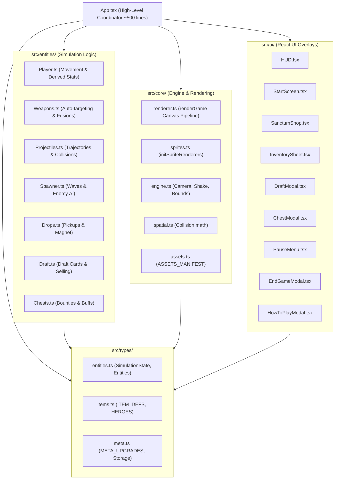

# Architecture Refactoring Plan — Relic Swarm

> **Status**: Ready for User Review & Approval  
> **Target**: Decouple `App.tsx` (~5,620 lines) into modular domain modules (`src/types`, `src/core`, `src/entities`, `src/ui`) in accordance with [`GEMINI.md`](file:///c:/git/mine/typescript/relicswarm/GEMINI.md#L109-L133).

---

## 1. Goal Description

`App.tsx` has historically grown into a 5,621-line monolith housing all TypeScript interfaces, sprite definitions, balance tables, procedural spawner logic, weapon casting, collision calculations, canvas rendering routines, and all 9 UI modal overlays.

While the sub-modules have already been created and verified in `src/` in commits `c3f9e4d` and `84842be`, `App.tsx` is still currently housing the original duplicated inline logic.

This plan outlines the final step of the refactoring: **rewiring `App.tsx` into a lightweight, high-level coordinator (~500 lines)** that imports and delegates to the decoupled domain layers while preserving 100% of the game invariants and features.



---

## 2. Hard Engineering Invariants to Preserve

1. **Gamepad Pause Restriction**:
   - Gamepad pause must strictly bind to **Button 9 (Options / Start)**.
   - Stick clicks (buttons 10 & 11) must never trigger pause.
2. **Three-Way Input Scheme Parity**:
   - Every modal (`SanctumShop`, `StartScreen`, `DraftModal`, `InventorySheet`, `PauseMenu`, `EndGameModal`, `HowToPlayModal`, `ChestModal`) supports:
     1. **Gamepad**: D-pad / Left Stick navigation, Button A (0) to confirm, Button B (1) to cancel, Button Y (3) for reroll/sell.
     2. **Keyboard**: WASD / Arrow Keys, Enter / Space to confirm, Escape / Backspace to cancel, numeric hotkeys [1]-[3], Tab / I for sell.
     3. **Pointer / Mouse**: Hover (`onPointerEnter`) synchronizes focus index; clicking triggers action.
3. **Standalone Runtime & Offline Compatibility**:
   - Keep `usePlayground` integration and `(window as any).__PLAYGROUND_PREVIEW__` compatibility.
4. **Zero Allocations in RAF Game Tick**:
   - 60 FPS fixed-stepper simulation loop continues mutating the existing `simRef.current` state in place with no heap array/closure allocations in `update` or `renderGame`.
5. **Storage Compatibility**:
   - LocalStorage keys: `relic_swarm_sanctum_gold`, `relic_swarm_gold`, `relic_swarm_meta`.

---

## 3. Proposed Changes in `App.tsx`

### [MODIFY] `App.tsx`
Replace the 5,621-line monolith with a ~500-line coordinator structured into clean sections:

1. **Imports & Setup**:
   - React hooks (`useState`, `useRef`, `useCallback`, `useEffect`).
   - Domain Types: `SimulationState`, `EquippedItem`, `ChestRewardData`, `ItemDef`, `HEROES`, `META_UPGRADES`, storage helpers.
   - Core Modules: `ASSETS_MANIFEST`, `BACKGROUND_MUSIC_URL`, `initSpriteRenderers`, `renderGame`.
   - Entity Logic: `calculateDerivedStats`, `updatePlayerMovement`, `updateWeaponCasting`, `updateProjectiles`, `updateEnemySpawner`, `updateEnemies`, `updateDrops`, `generateDraftChoices`, `applyUpgradeSelection`, `sellEquippedItem`, `generateChestReward`, `applyChestReward`.
   - UI Modals: `HUD`, `StartScreen`, `SanctumShop`, `InventorySheet`, `DraftModal`, `ChestModal`, `PauseMenu`, `EndGameModal`, `HowToPlayModal`.

2. **Simulation State (`simRef`)**:
   - Initializes `SimulationState` with `HEROES[0]` and default attributes.

3. **Core Action Handlers**:
   - `getCalculatedStats()`: delegates to `calculateDerivedStats(simRef.current, metaLevels)`.
   - `initGame(heroIdx)`: initializes simulation, equips starting loadout, resets camera/timers, triggers audio.
   - `triggerLevelUp()`: fetches choices via `generateDraftChoices` and opens modal.
   - `selectUpgrade(item)`: applies upgrade via `applyUpgradeSelection`.
   - `handleReroll()`: decrements available reroll and refreshes draft choices.
   - `sellItem(itemId)`: sells item via `sellEquippedItem`.
   - `buyMetaUpgrade(upgId)`: checks gold, updates `metaLevels`, saves persistent storage.
   - `triggerPauseMenuAction(actionIdx)`: handles options 0 to 6 in Pause Menu Tab 3.
   - `claimChestReward()`: applies reward via `applyChestReward`.

4. **Game Loop (`update` and `draw`)**:
   - Fixed stepper ticker runs `update(dt)`:
     - Gamepad input handling & navigation cooldown tick.
     - Modal gamepad navigation (Start, Pause, Draft, Inventory, Sanctum, Chest, GameOver/Victory).
     - Gameplay updates when active: `updatePlayerMovement`, `updateWeaponCasting`, `updateProjectiles`, `updateEnemySpawner`, `updateEnemies`, `updateDrops`, particles/damage number life decay.
   - `draw(ctx)`:
     - Single call to `renderGame(ctx, simRef.current, stats, assets, spriteRenderersRef.current, canvasWidth, canvasHeight)`.

5. **Keyboard & Focus Auto-Scroll Listeners**:
   - Preserves all keyboard shortcuts across all states.
   - Smooth auto-scrolling on focus index changes in `SanctumShop`, `InventorySheet`, and `PauseMenu`.

6. **JSX Layout**:
   - Fixed container with `BackgroundMusic` and `canvas`.
   - Declarative UI component mounts:
     ```tsx
     <HUD ... />
     <StartScreen ... />
     <SanctumShop ... />
     <InventorySheet ... />
     <DraftModal ... />
     <ChestModal ... />
     <PauseMenu ... />
     <EndGameModal ... />
     <HowToPlayModal ... />
     ```

---

## 4. Verification Plan

### Automated Build Verification
Execute the production build to ensure 0 TypeScript or bundling errors:
```bash
npm run build
```

### Manual Verification Checklist
1. **Game Start & Hero Select**:
   - Verify character carousel navigation (WASD/Arrows, Gamepad D-pad, mouse clicks).
   - Verify starting weapon and class trait preview for all 4 champions.
   - Verify pressing Enter / Button A starts the run.
2. **Gameplay & Movement**:
   - Verify movement (WASD, Gamepad Left Analog, mobile touch joystick).
   - Verify sprint (Shift, Gamepad Button B/RT, mobile sprint button) depletes stamina and recovers when stopped.
   - Verify auto-firing weapons targeting nearest enemies.
3. **Arsenal Sell Sheet**:
   - Verify pressing `Tab`, `I`, or Gamepad `Y` opens the sell sheet.
   - Verify selling items refunds 70% gold and frees up the slot.
   - Verify full navigation via keyboard and controller.
4. **Pause Menu**:
   - Verify Button 9 (Options/Start) toggles pause menu. Verify stick clicks do NOT pause.
   - Verify Tab 1 (Stats & Arsenal) with "Manage & Sell Arsenal" button.
   - Verify Tab 2 (Grimoire) evolution guide.
   - Verify Tab 3 (Settings) navigation across all 7 items with keyboard and controller.
5. **Level-Up Draft**:
   - Verify collecting gems triggers Level Up Draft.
   - Verify picking cards with [1]-[3], Enter, or Gamepad A.
   - Verify reroll with R or Gamepad Y.
6. **Sanctum Meta-Shop**:
   - Verify opening shop via S / X or menu button.
   - Verify navigation across upgrades and purchasing ranks.
   - Verify persistence in localStorage after run ends.
7. **Game Over & Victory**:
   - Verify defeat screen upon 0 HP with stats summary and Quick Restart [A / Enter].
   - Verify victory screen upon defeat of the Abyssal Titan.
